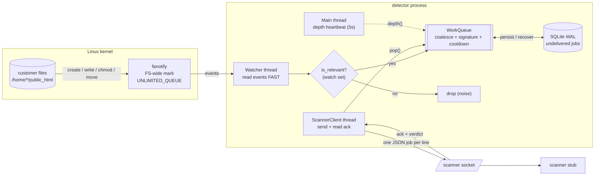
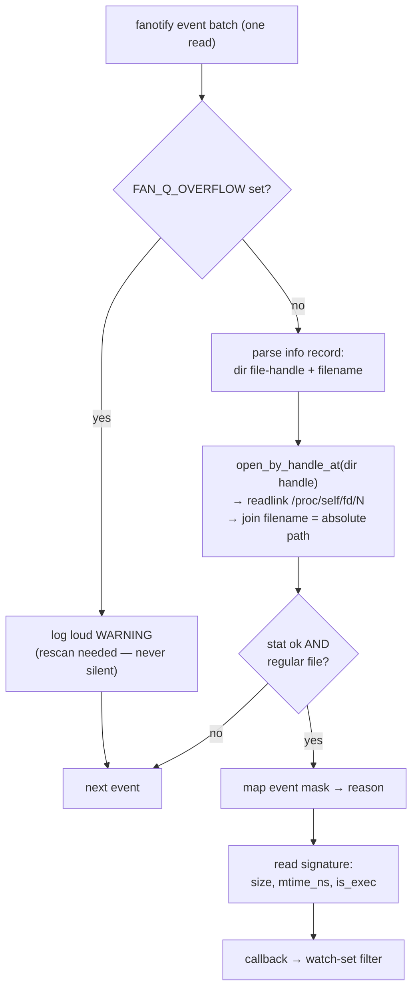
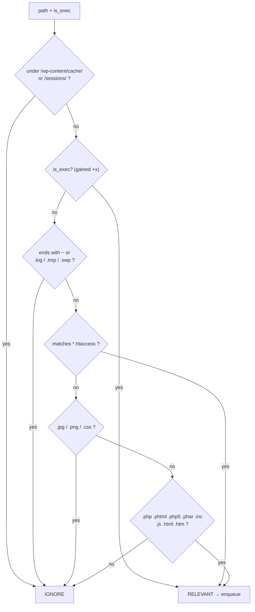
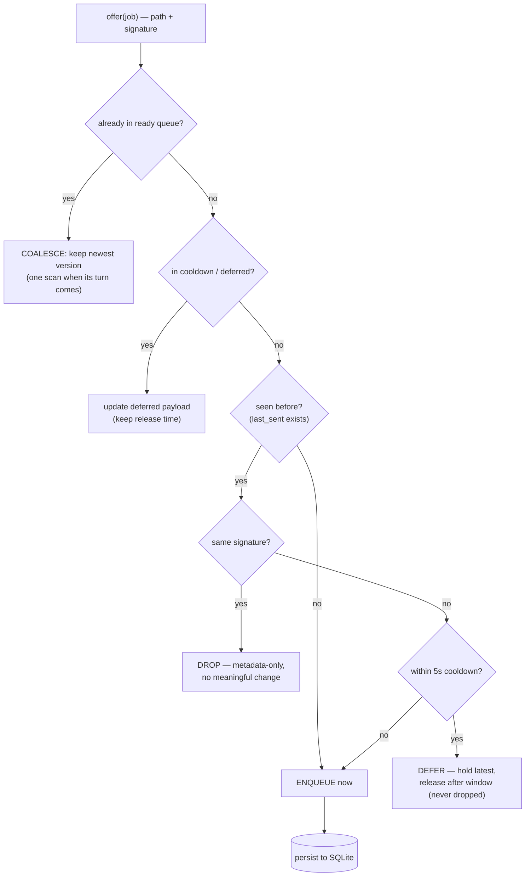
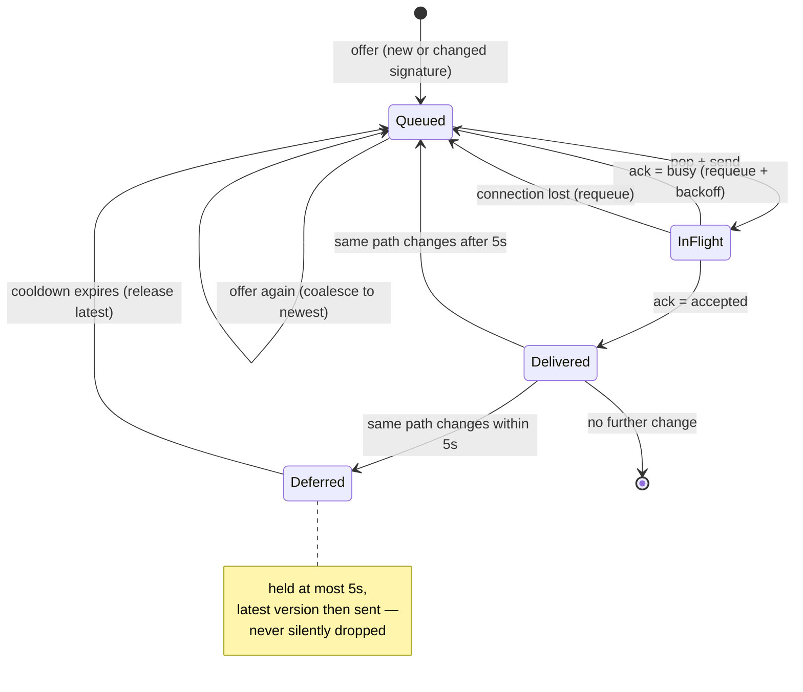
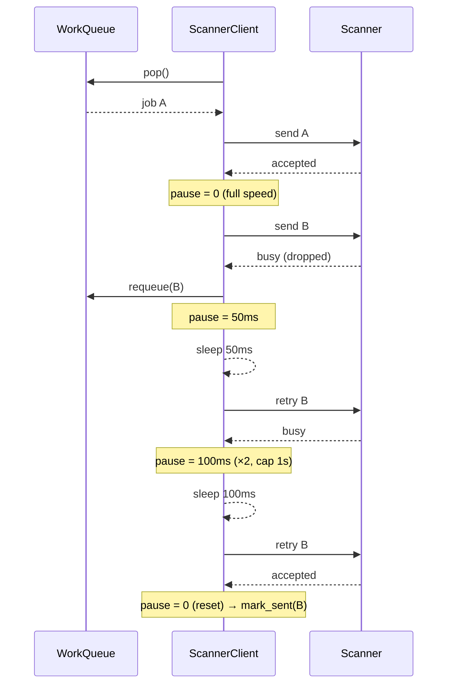
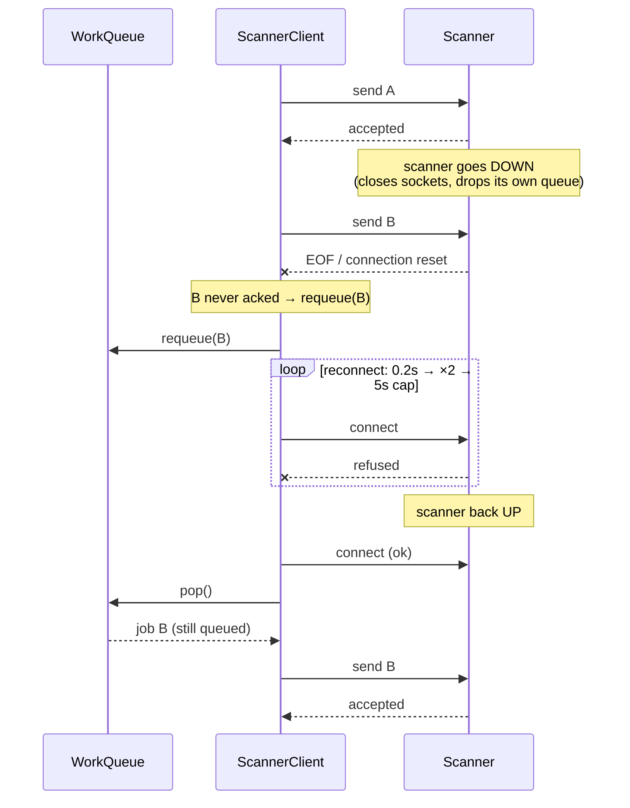
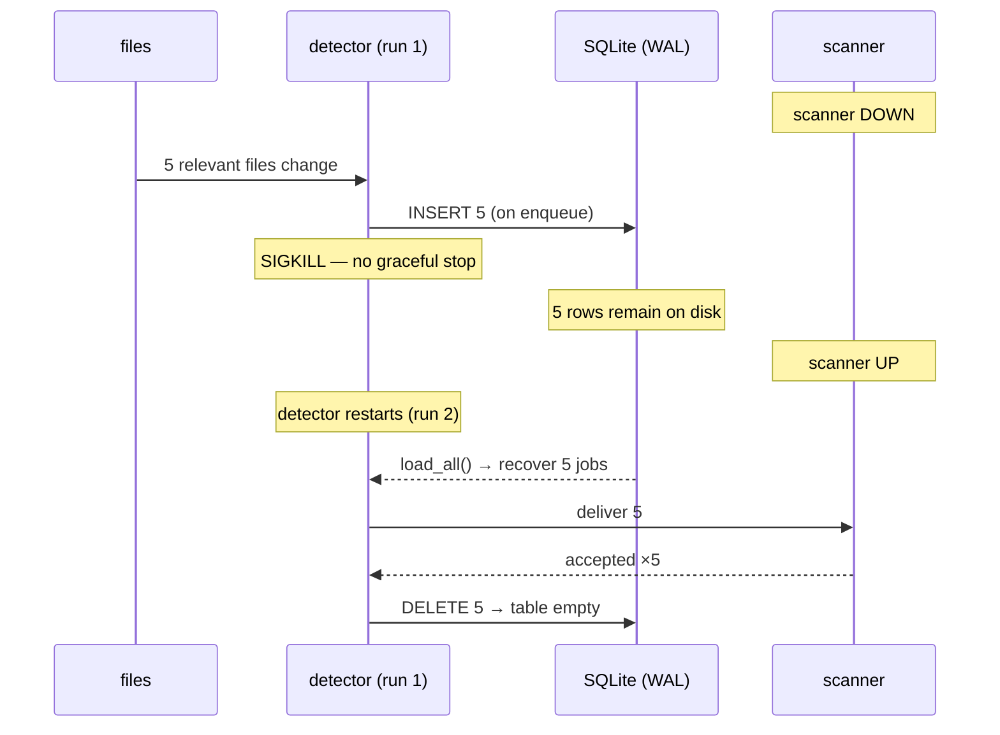
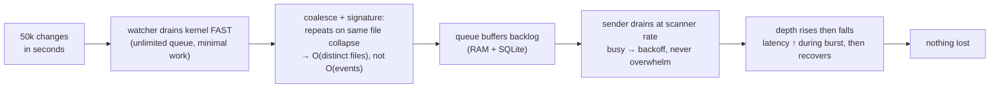

# Detector — Architecture & Flows

How changes are detected, filtered, de-duplicated, and delivered — with the exact
flow for every scenario (retries, backpressure, scanner downtime, detector crash,
kernel overflow). Diagrams are Mermaid; they render in the IDE and on GitHub.

- Detection: [detector/fanotify_watcher.py](detector/fanotify_watcher.py) (fallback [detector/poll_watcher.py](detector/poll_watcher.py))
- Filter: `is_relevant()` in [detector/detector.py](detector/detector.py)
- De-dup + queue + durability: [detector/work_queue.py](detector/work_queue.py)
- Delivery + retry + reconnect: [detector/scanner_client.py](detector/scanner_client.py)

---

## 1. The approach in one line

Watch the whole filesystem with **one fanotify mark**, keep the kernel reader
dumb and fast so nothing is ever missed, push *relevant* changes into a
**durable, de-duplicating queue**, and drain that queue to the scanner with
**backpressure-aware retries** that survive the scanner going down and the
detector itself crashing.

---

## 2. System architecture

Three threads share one durable queue. The watcher produces; the client consumes;
the main thread just reports backlog depth.

**Why this shape:** the queue decouples the fast side (kernel firing 50k events in
seconds) from the slow side (scanner accepting ~200/s). The kernel never waits on
the scanner; bursts, backpressure, and downtime all become "the queue holds it."

---

## 3. Change detection — one fanotify event → one job

The reader does the minimum per event (so the kernel queue can't overflow), then
rebuilds the absolute path from the directory file-handle + name.

**Event → reason mapping** (and why these events):

| fanotify event | reason | why it's watched |
| :-- | :-- | :-- |
| `FAN_CREATE` | `created` | a new file appeared (dropped shell) |
| `FAN_MOVED_TO` | `replaced` | atomic save / move into place |
| `FAN_CLOSE_WRITE` | `modified` | fires **once on close**, not per `write()` — kills duplicate noise at the source |
| `FAN_ATTRIB` | `modified` | permission change → re-`stat` and apply the **+x** rule |

---

## 4. Watch set — is this change relevant?

`+x` wins over extension (a newly-executable file is the strongest payload tell);
excluded dirs win over everything.

---

## 5. Deduplication — what counts as a duplicate

A job's **identity is its signature `(size, mtime, is_exec)`**. "Duplicate" means
*no meaningful change* since the last scan; a new signature is never a duplicate.

### Duplicate / not-duplicate scenarios

| Scenario | Signature moves? | Result |
| :-- | :-- | :-- |
| Content edited (write + close) | size/mtime change | **SCAN** |
| Gains execute bit (`chmod +x`) | is_exec flips | **SCAN** |
| Replaced via move/atomic-save | new content at path | **SCAN** (`replaced`) |
| `chown`/`chgrp` only | nothing (exec unchanged) | **DROP** (ATTRIB fires, signature identical) |
| `touch` / atime bump, same content | no write → no `CLOSE_WRITE` event at all | **ignored at source** |
| Read / open without write | no watched event | **ignored at source** |
| Same file rewritten 8× in 1s | each write new signature | **COALESCE + COOLDOWN → 1–2 scans** |
| Rewritten again after a scan, within 5s | new signature | **DEFER → 1 more scan after window (not lost)** |
| `.swp` / `~` / `.log` / `.tmp` | n/a | **excluded** (watch set) |
| `wp-content/cache/`, `sessions/` | n/a | **excluded** (dir) |
| `.jpg` / `.png` / `.css` | n/a | **excluded** (unless it gains +x) |

### Job lifecycle (per path)

---

## 6. Backpressure — the scanner says `busy`

`busy` means the scanner **dropped** the job. The whole sender pauses (not per
file), because one scanner means backpressure is global. Pause: 0 → 50ms → ×2 →
1s cap; reset to 0 on the next success.

---

## 7. Scanner downtime — reconnect + replay

The scanner closing the socket shows up as an EOF / write error. The in-flight job
was never acked, so it goes **back on the queue**; we reconnect with backoff and
resume. Nothing is lost because everything waits in the (durable) queue.

---

## 8. Detector crash — SQLite recovery

The queue persists every *undelivered* job. A hard `SIGKILL` loses in-memory
state, but the backlog is on disk and is reloaded on restart.

**What is / isn't persisted:** only the undelivered set (enqueue = `INSERT OR
REPLACE` on `path`; delivery = `DELETE` the exact version). `last_sent`/cooldown
state is in-memory only — losing it can cause a harmless re-scan, never a miss.

---

## 9. Burst / active infection — end to end

Tens of thousands of changes in seconds across many accounts:

**Central trade-off (see RATIONALE.md):** this path chooses **never-lose** over
strictly-bounded resources — the backlog is bounded by *distinct undelivered
files* (coalescing) and spilled to disk, and overflow is shouted, not swallowed.
