# Detector — Design & Rationale

The component that sits between customer file systems and the scanning service.
It watches for **relevant** file changes and submits them to the scanner:
without overwhelming it, without re-submitting the same file in a tight window,
without ever **silently** losing a change, and without losing work while the
scanner is down (or while the detector itself restarts).

- Code: `detector/` — run via `detector/run.sh` with `SEED_TREE` + `SCANNER_SOCKET`.
- End-to-end test walkthrough: `TESTING.md`.

---

## 1. Architecture at a glance

One process, two worker threads, one durable queue in the middle. The queue
**decouples** the fast side (the kernel firing tens of thousands of events in
seconds) from the slow side (the scanner accepting ~200/s).

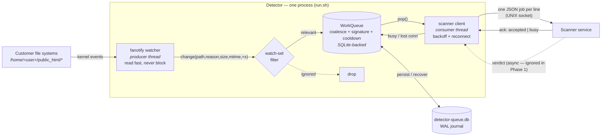

**Why this shape:** the queue is a shock absorber. The kernel never waits for the
scanner. Every failure path (`busy`, disconnect, our own crash) funnels back into
"it's still safely in the queue, try again" — that is how "every relevant change
eventually reaches the scanner" is guaranteed.

---

## 2. How changes are detected (fanotify)

### Why fanotify, not inotify
One `FAN_MARK_FILESYSTEM` mark watches the **whole filesystem** under the tree —
every account, every sub-directory, and directories created *later* — in a single
call. inotify needs one watch **per directory**, doesn't recurse, exhausts
`max_user_watches`, and misses changes during the initial walk. For 2000 accounts
/ millions of files, fanotify is the one that scales.

| | inotify | **fanotify (chosen)** |
| :-- | :-- | :-- |
| Watch whole tree in one call | ❌ per-directory | ✅ one FS-wide mark |
| New sub-dirs auto-covered | ❌ race to add watch | ✅ automatic |
| Scales to millions of files | ❌ watch limit / slow start | ✅ built for it |
| Needs root | no | **yes (CAP_SYS_ADMIN)** |

### Detection flow

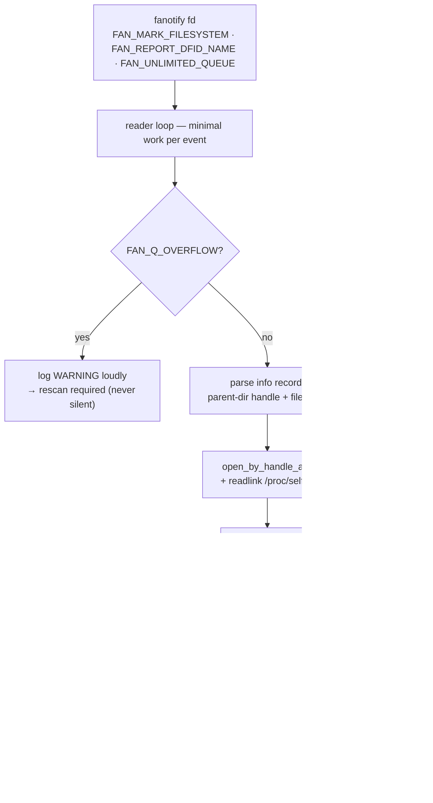

### Which kernel events, and why

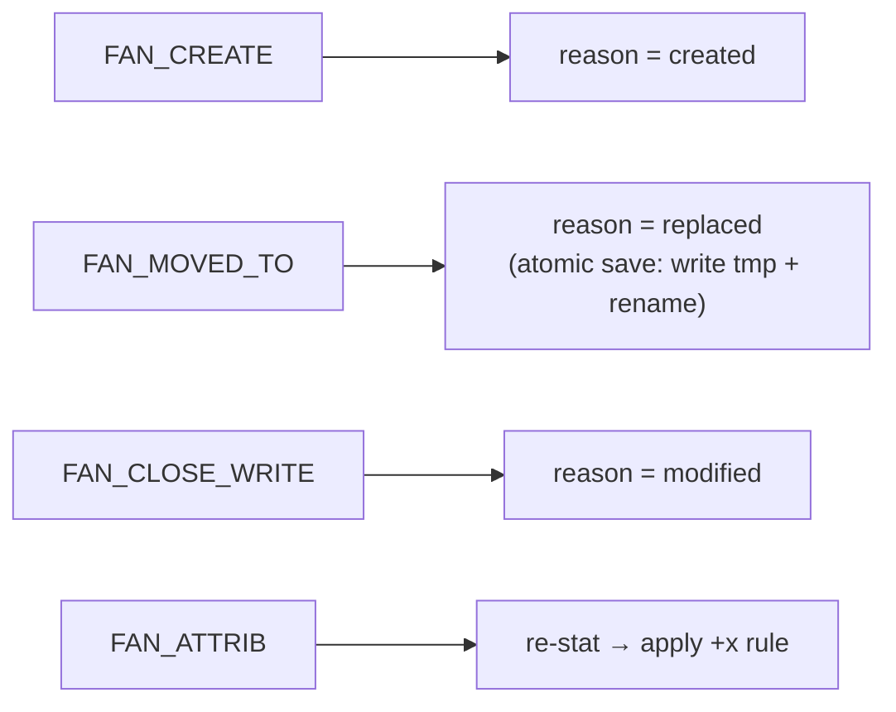

- **`FAN_CLOSE_WRITE`** (fires once, when the writer *closes* the file) is used
  instead of `FAN_MODIFY` (fires on every `write()`). A file written in 50 chunks
  is **one** event, not 50 — most duplicate noise is killed at the source.
- **`FAN_ATTRIB`** is how we catch a `chmod +x`. The event doesn't say *what*
  changed, so we `stat()` and check the execute bit.
- The reader stays deliberately dumb + `FAN_UNLIMITED_QUEUE`, so a burst can't
  overflow the kernel queue and make us miss changes.

### Monitoring multiple disks / filesystems

A fanotify `FAN_MARK_FILESYSTEM` mark covers **one filesystem (one superblock)**.
Fleet servers often spread document roots across several mounted disks
(`/home`, `/var/www`, `/data/addon`, …), so we add **one mark per filesystem** —
all on the **same** fanotify handle, so every disk's events share one queue, one
dedup, and one backpressure loop. **One service per server, not one per disk.**

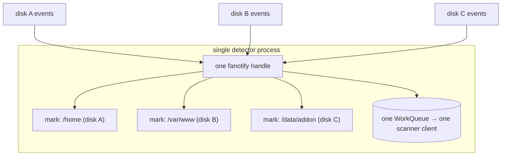

Configure it with `WATCH_ROOTS` (comma-separated); it defaults to `SEED_TREE`:

```bash
WATCH_ROOTS=/home,/var/www,/data/addon  SCANNER_SOCKET=... ./detector/run.sh
```

Path resolution works across disks because a file handle only resolves against a
mount fd **on its own filesystem**: we keep one mount fd per watched root and try
each until the handle resolves. A mark that fails (e.g. a path that isn't a mount
point) is logged and skipped; the detector keeps watching the rest. *(Verified on
two separate filesystems — ext4 + tmpfs — in the container test.)*

---

## 3. What counts as a *relevant* change (the watch set)

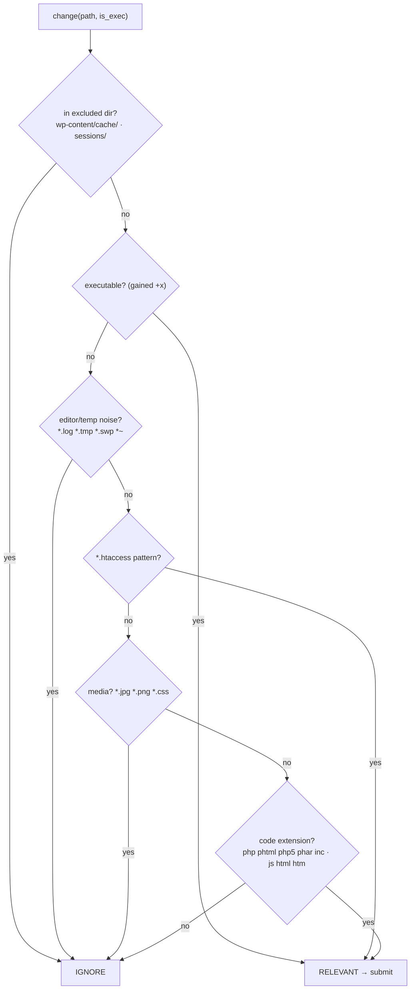

**Order matters:** `+x` is checked **before** the noise/media filters because a
newly-executable file is the strongest payload signal — it wins over extension.
`*.htaccess` is a **pattern**, so `inj_000061.htaccess` counts, not just the
literal `.htaccess`.

---

## 4. Deduplication — when is a file a "duplicate"?

The PO's definition: a scan should correspond to a **meaningful change** — new
content, replaced content, or a new execute permission. Anything else (a read, an
`atime`/`mtime` touch with no new bytes, a `chown`, an editor temp file) is a
duplicate/unnecessary scan.

We enforce this with **two cooperating layers**:

1. **Event layer (fanotify):** we only subscribe to `CREATE / MOVED_TO /
   CLOSE_WRITE / ATTRIB`. A pure `touch` (atime/mtime only, no write) produces
   **no** `CLOSE_WRITE`, so it never even reaches us.
2. **Signature layer (queue):** a job's identity is
   **`signature = (size, mtime_ns, exec-bit)`**. If the signature equals the last
   one we delivered, nothing meaningful changed → drop. New content moves
   `size`/`mtime`; a `chmod +x` flips `exec`; a `chown` moves none → dropped.

Plus **coalescing** (same path queued twice collapses) and a **cooldown** (rapid
re-writes of a just-scanned file are held, newest released after the window).

### Duplicate / not-duplicate scenarios

| Scenario | Event we get | Signature changes? | Result |
| :-- | :-- | :-- | :-- |
| New `.php` created & written | CREATE + CLOSE_WRITE | n/a (new) | **scan** (created) |
| Content edited | CLOSE_WRITE | yes (size/mtime) | **scan** (modified) |
| Atomic replace (tmp + rename) | MOVED_TO | yes | **scan** (replaced) |
| File gains `+x` | ATTRIB | yes (exec bit) | **scan** |
| Already-scanned file edited **again** (new bytes) | CLOSE_WRITE | yes | **scan** (after cooldown) |
| Same file rewritten 50×/sec | 50× CLOSE_WRITE | yes each | **1–2 scans** (coalesce + cooldown) |
| Read / open-for-read | (none subscribed) | — | **ignore** |
| `atime`/`mtime` touch, no new bytes | (no CLOSE_WRITE) | — | **ignore** |
| `chown` / group change only | ATTRIB | no | **ignore** (signature identical) |
| Rename with no content change | MOVED_TO | same content | effectively ignored (same signature) |
| Editor temp `.swp` / `file.php~` | (any) | — | **ignore** (watch-set) |
| File in `wp-content/cache/` | (any) | — | **ignore** (excluded dir) |

### The `offer()` decision (exact flow)

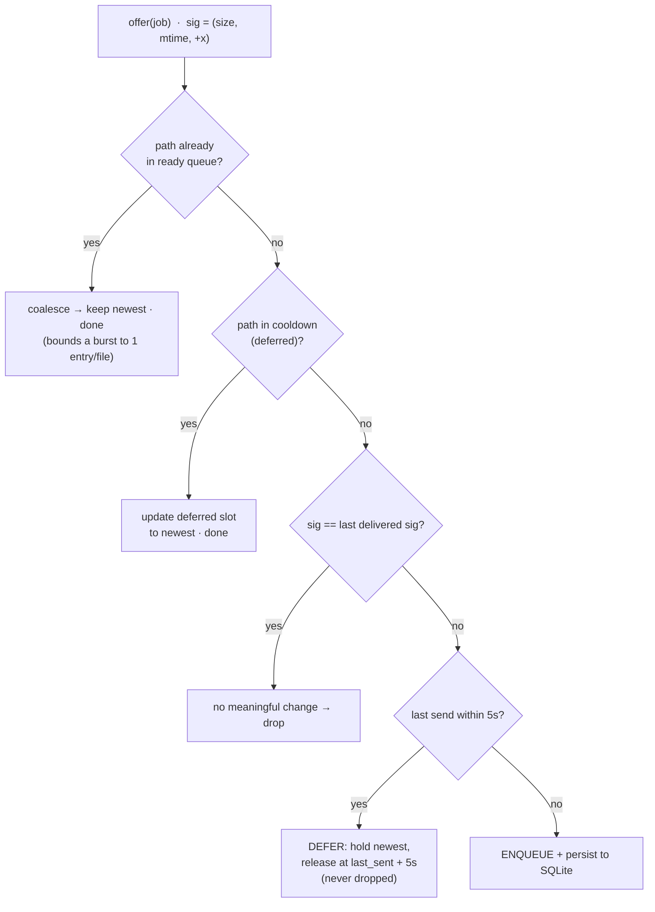

> **Key property:** the cooldown **defers**, it does not **drop**. A genuinely new
> change that lands inside the window is delayed at most 5s, never lost — this is
> the never-lose vs. throughput tradeoff made explicit (see §10).

---

## 5. Job lifecycle (state machine)

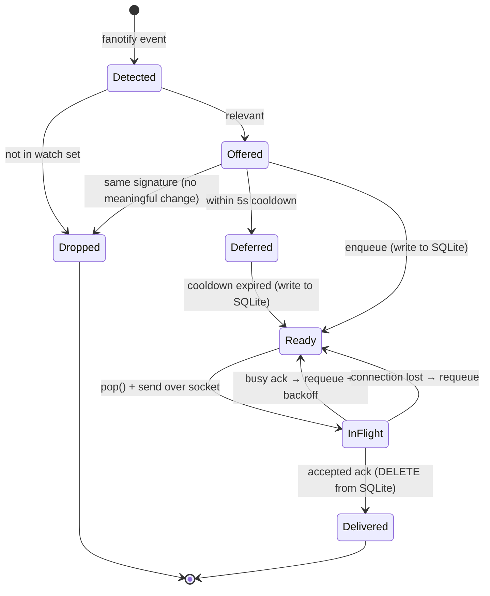

A job is on disk from **Ready** through **InFlight**; it is only `DELETE`d when the
scanner **accepts** it. So any crash in between is recoverable.

---

## 6. Backpressure — the scanner says `busy`

`busy` means the scanner's intake queue is full and it **dropped** the job. The
rule: put it back and pause the **whole** sender (the scanner is busy for
everything, not one file). Pause: `0 → 50ms → double → 1s cap`, reset to `0` on
the next success.

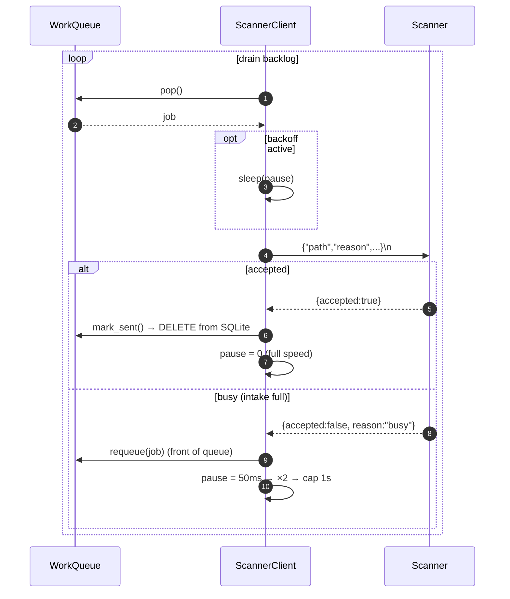

During a 50k burst the sender simply drains at the scanner's pace while the queue
holds the backlog. Latency rises during the burst (expected) and recovers after.

---

## 7. Scanner downtime — disconnect, reconnect, replay

When the scanner goes down it closes the socket (and drops its own queue). We:
rescue the in-flight job, reconnect with backoff, and resume draining — the
backlog was safe in the (persistent) queue the whole time.

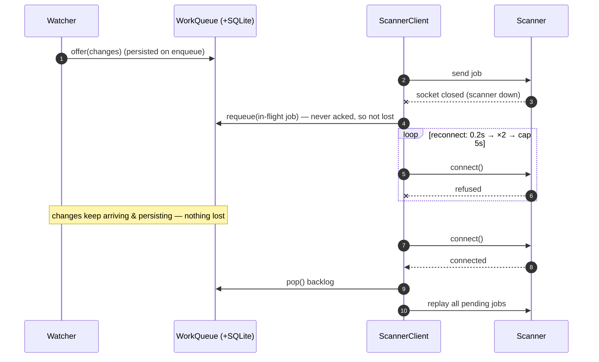

---

## 8. Detector crash — SQLite recovery (the durability net)

If the **detector process itself** dies (OOM-kill, deploy, panic) while a backlog
is waiting, the backlog is on disk and is reloaded on restart.

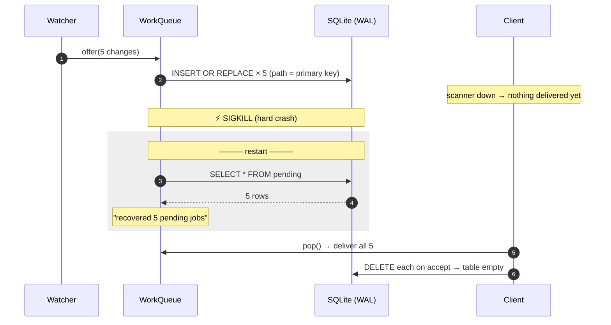

**What is / isn't persisted:**

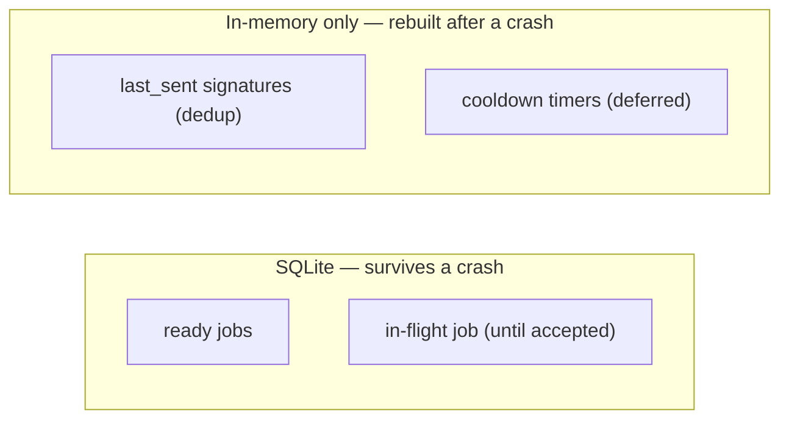

Cooldown/last-sent are **not** persisted on purpose: losing them can only cause a
harmless re-scan, never a miss. The authoritative "still must send" set is on disk.

---

## 9. Burst handling & kernel-overflow protection

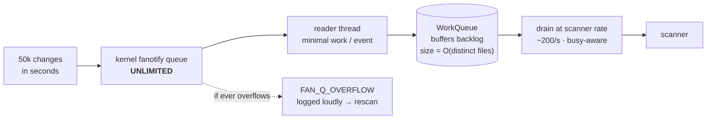

Coalescing means the backlog is bounded by the number of **distinct** changed
files, not by the number of events — a rewrite-storm on the same files stays tiny.

---

## 10. Failure matrix

| Failure | Detection | Handling | Guarantee |
| :-- | :-- | :-- | :-- |
| Scanner `busy` | ack `accepted:false` | requeue + exponential backoff | not lost; scanner not overwhelmed |
| Scanner down | socket EOF / write error | requeue in-flight + reconnect loop + replay | not lost during downtime |
| Detector crash | — | SQLite reload on restart | backlog survives process death |
| Kernel queue overflow | `FAN_Q_OVERFLOW` | log loudly → rescan | never a **silent** loss |
| Malformed/over-long job | ack `bad_request` | log + drop (shouldn't happen; we emit valid JSON) | no infinite loop |
| File deleted before stat | `stat()` raises | skip | no crash |
| Old kernel (<5.9) / not root | `fanotify_init`/`mark` fails | fall back to polling watcher | still works (slower) |

---

## 11. The central trade-off

You cannot simultaneously guarantee **never-lose** and **strictly-bounded
resources**. **I chose never-lose**, because the stated worst outcome is burying
the one malicious change; silently dropping under pressure defeats the product.

What keeps it sane: the backlog is **O(distinct undelivered files)** (coalescing),
and it lives on disk, so RAM isn't the hard ceiling. Accepted cost: a *prolonged*
outage touching a *huge number of distinct files* grows disk usage; if disk were
truly exhausted we fail **loudly**, never drop. Operationally we alert on queue
depth (logged every 5s) and scale/restore the scanner.

### (a) Strongest objection to my own approach
Never-lose + disk-backed queue is **weaponizable**: an attacker who triggers a
massive distinct-file change storm *while the scanner is down* (or who DoSes the
scanner) can balloon the backlog to exhaust disk/inodes or slow recovery — turning
a scanner outage into a detector/host outage. A strictly-bounded design degrades
more predictably under that attack. (Secondary: SQLite commit-per-op is on the hot
path; WAL keeps it cheap, but extreme sustained load would need batched commits.)
**Rebuttal:** in this domain a noisy resource alert beats a silent miss, and the
coalesced O(distinct-files) bound + depth alerting keeps it manageable. For a
hostile edge, I'd ship a bounded variant (hard cap + shed-oldest, each shed paired
with a scheduled rescan so "shed" still isn't "silently lost").

### (b) What I took from, and rejected in, my AI assistant's output
**Took:** fanotify-over-inotify; `FAN_CLOSE_WRITE` over `FAN_MODIFY`;
signature-based dedup; coalesce + cooldown; the exponential-backoff shape;
reconnect-and-replay; `FAN_UNLIMITED_QUEUE` / overflow awareness; the
producer/consumer structure.

**Rejected / changed — design tradeoffs where its first answer was weaker:**
- **Durability: in-memory → disk-backed.** It modelled the queue as in-memory only
  and filed persistence as "future work" — which quietly trades away never-lose
  the moment the detector itself crashes. I made it **SQLite (WAL) now**. Tradeoff:
  a small hot-path write for a backlog that survives a restart.
- **Dedup identity: time-window → meaningful-change signature.** Its first dedup was
  a pure time debounce, which both rescans metadata-only noise *and* can skip a real
  edit inside the window. I changed the key to **`(size, mtime, +x)`**. Tradeoff: a
  little `stat` work for correct "did it *meaningfully* change" semantics.
- **Cooldown must defer, not drop.** Its cooldown would have *suppressed* in-window
  changes, which can bury a malicious rewrite right after a scan. I made it **hold
  the latest and release it**. Tradeoff: ≤5s added re-scan latency over any miss
  risk (we also tuned the window 2s → 5s).
- **Never-lose at the kernel boundary.** It relied on the default bounded kernel
  queue, where a burst can drop events **invisibly**. I required
  `FAN_UNLIMITED_QUEUE` + explicit `FAN_Q_OVERFLOW` detection. Tradeoff: unbounded
  kernel memory vs. guaranteed completeness.

---

## 12. Requirements mapping

| Requirement | How it's met |
| :-- | :-- |
| Scanner never overwhelmed | send only while connected; `busy` → requeue + exponential backoff |
| No repeat submit in a short window | coalesce + signature + 5s deferred cooldown |
| New/changed file never **silently** lost | never-lose queue + retry; new signature always enqueued (even mid-cooldown); overflow logged, not swallowed |
| No loss during scanner downtime | persistent SQLite queue + reconnect/replay; survives detector SIGKILL |

---

## 13. Known limits / future work
- In-memory index mirrors the DB (RAM ≈ O(distinct undelivered files)); for
  millions of simultaneously-pending files, page the index from disk.
- Cooldown can delay a legitimate re-scan by up to 5s (tunable).
- Overflow handler logs but doesn't yet auto-rescan; production would trigger a
  targeted rescan of the affected subtree.
- FID path reporting needs Linux 5.9+; older kernels fall back to polling.
- Multiple disks are supported via `WATCH_ROOTS` (one mark + mount-fd per
  filesystem; see §2). For *very* many filesystems, resolving a handle by trying
  each mount fd is O(#fs) per event — fine for a handful; map by `fsid` if a host
  mounts dozens of disks.
