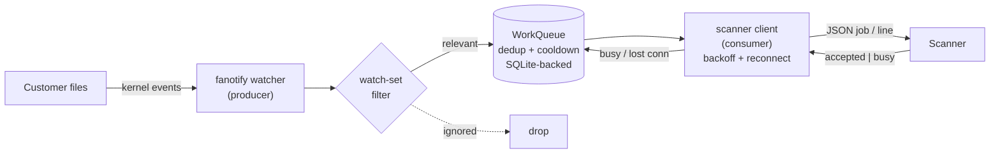

# Real-time file-change detector → scanner

A component that sits between customer file systems and the scanning service.
When a **relevant** file changes, it submits it to the scanner — without
overwhelming it, without duplicate scans, without ever **silently** losing a
change, and without losing work while the scanner (or the detector itself) is down.

> **Graded entry point:** [`detector/run.sh`](detector/run.sh), driven by
> `SEED_TREE` and `SCANNER_SOCKET`. All component code lives under
> [`detector/`](detector/).

---

## Quick start (Linux container — fanotify needs a real kernel)

```bash
docker build -f test/Dockerfile -t detector-test .      # fast, no apt
docker volume create cl_work

# one-shot automated test (seed → scanner → detector → burst → crash-recovery)
docker run --rm --privileged -v cl_work:/work detector-test
```

To drive it by hand and **watch scans stream live**, follow
**[TESTING.md](TESTING.md)** (build → `exec` in → run the provided seed/scanner/load
→ watch the detector submit scans).

---

## Documentation map

| Doc | What's in it |
| :-- | :-- |
| **[DESIGN.md](DESIGN.md)** | Full architecture, exact flows, and **Mermaid diagrams** for every scenario + the rationale |
| **[RATIONALE.md](RATIONALE.md)** | The Phase-2 submission note (trade-off, self-objection, AI attribution) |
| **[TESTING.md](TESTING.md)** | Build → exec in → run fixtures → watch detections live |
| **[detector/](detector/)** | The component (6 modules + `run.sh`) |

### Jump to a specific topic (in [DESIGN.md](DESIGN.md))

- [Architecture at a glance](DESIGN.md#1-architecture-at-a-glance) — the one-process, two-thread, durable-queue design
- [How changes are detected (fanotify)](DESIGN.md#2-how-changes-are-detected-fanotify) — why fanotify over inotify, event→reason mapping
- [What counts as a relevant change (watch set)](DESIGN.md#3-what-counts-as-a-relevant-change-the-watch-set) — the filter decision
- [Deduplication — when is a file a "duplicate"?](DESIGN.md#4-deduplication--when-is-a-file-a-duplicate) — signature + coalesce + cooldown, with a full scenario table
- [Job lifecycle (state machine)](DESIGN.md#5-job-lifecycle-state-machine)
- [Backpressure — `busy` + exponential backoff](DESIGN.md#6-backpressure--the-scanner-says-busy)
- [Scanner downtime — disconnect, reconnect, replay](DESIGN.md#7-scanner-downtime--disconnect-reconnect-replay)
- [Detector crash — SQLite recovery](DESIGN.md#8-detector-crash--sqlite-recovery-the-durability-net)
- [Burst handling & kernel-overflow protection](DESIGN.md#9-burst-handling--kernel-overflow-protection)
- [Failure matrix](DESIGN.md#10-failure-matrix) — every failure → how it's handled
- [The central trade-off](DESIGN.md#11-the-central-trade-off) — never-lose vs bounded resources, + self-objection + AI attribution
- [Requirements mapping](DESIGN.md#12-requirements-mapping)
- [Known limits / future work](DESIGN.md#13-known-limits--future-work)

---

## How it works (30-second version)



1. **Detect** — one fanotify filesystem-wide mark catches every create/modify/
   move/chmod across all accounts (scales where inotify can't).
2. **Filter** — keep only `*.php/.phtml/.php5/.phar/.inc`, `*.htaccess`,
   `*.js/.html/.htm`, and **any file that gains `+x`**; drop media, temp, cache.
3. **Dedup** — a job's identity is `(size, mtime, +x)`; same signature = no
   meaningful change = skip. Coalesce queued repeats; a 5s cooldown **defers**
   (never drops) rapid re-writes.
4. **Deliver** — submit over the UNIX socket; on `busy` back off (50ms→1s) and
   retry; on disconnect reconnect and replay; persist undelivered jobs to **SQLite**
   so nothing is lost across a scanner outage **or a detector crash**.

**Central trade-off:** chose **never-lose** over strictly-bounded resources —
missing the one malicious file is the worst outcome. Full reasoning + the
strongest objection to this choice: [DESIGN.md §11](DESIGN.md#11-the-central-trade-off).

---

## Submitting

`submission.patch` is the unified diff of [`detector/`](detector/) only.
Regenerate with `./packaging/make-submission.sh`. The provided fixtures
([packaging/RUNBOOK.md](packaging/RUNBOOK.md)) are used **as-is**.
# cloudlinux-file-change-detector
